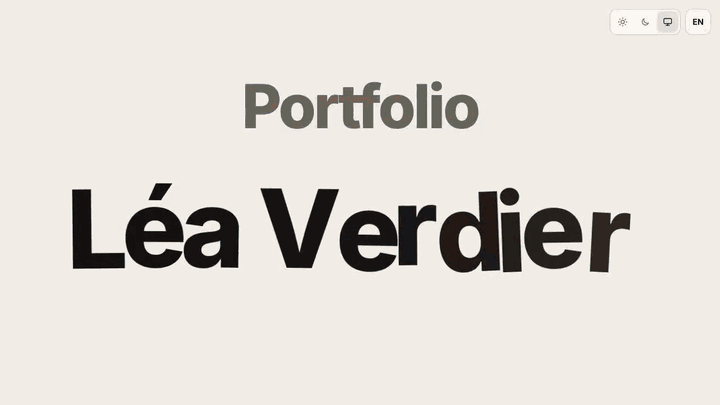
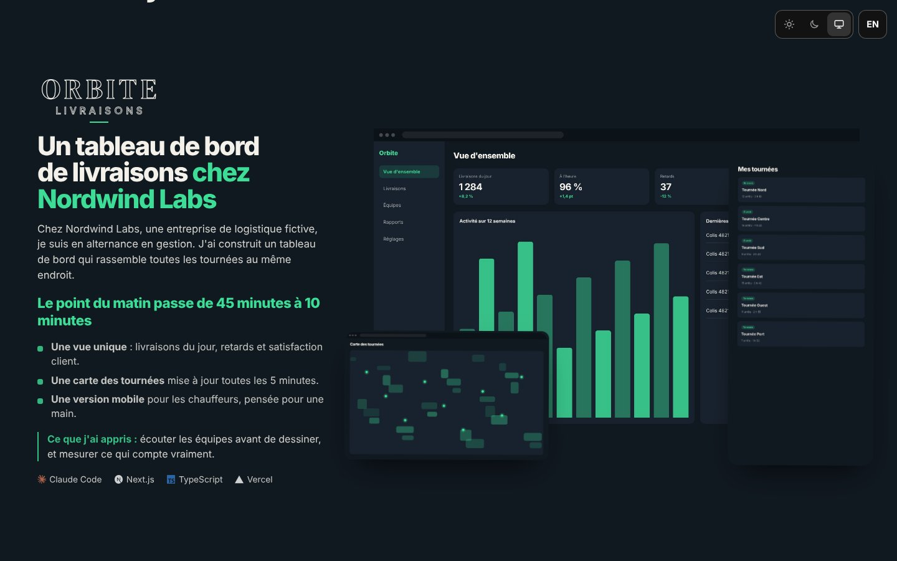
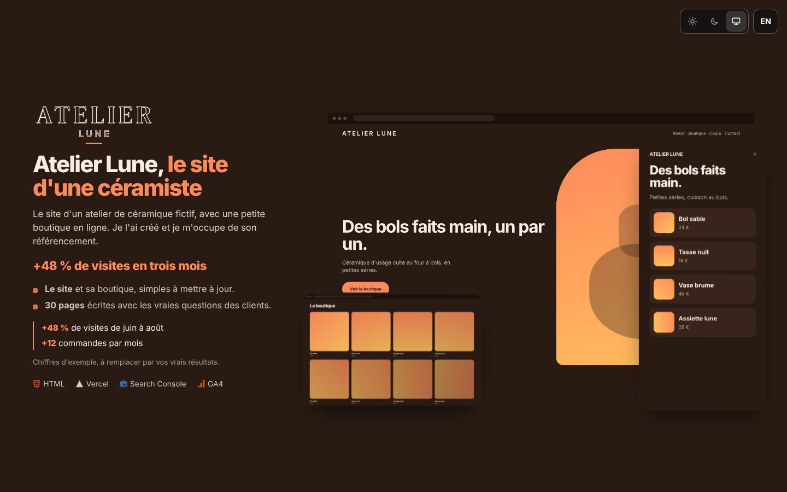
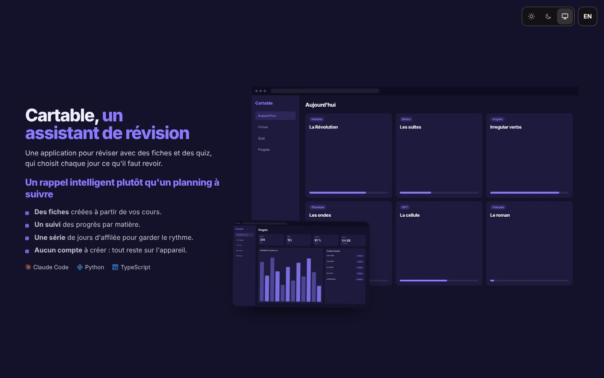
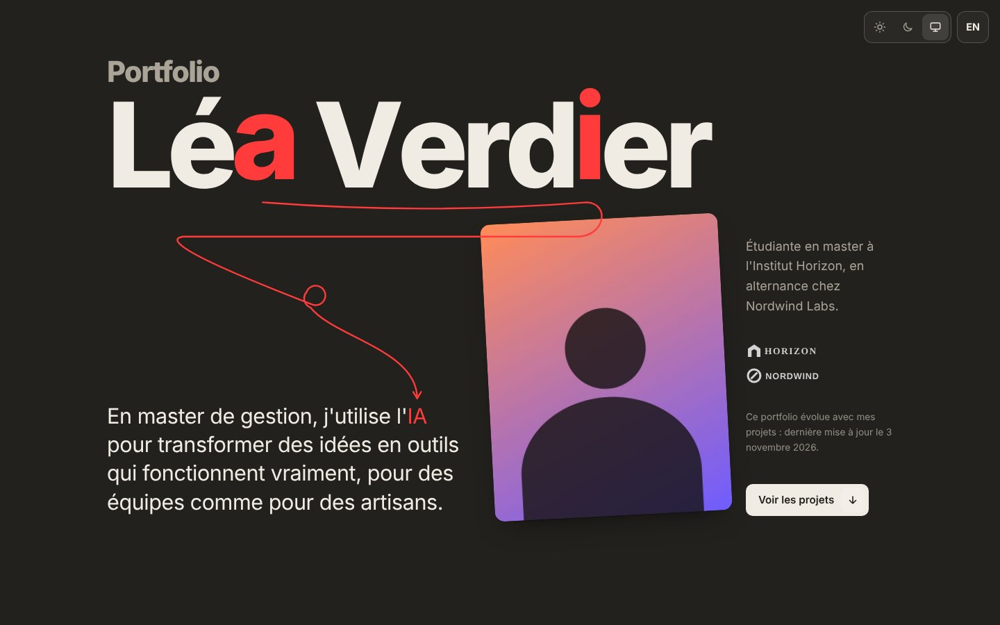
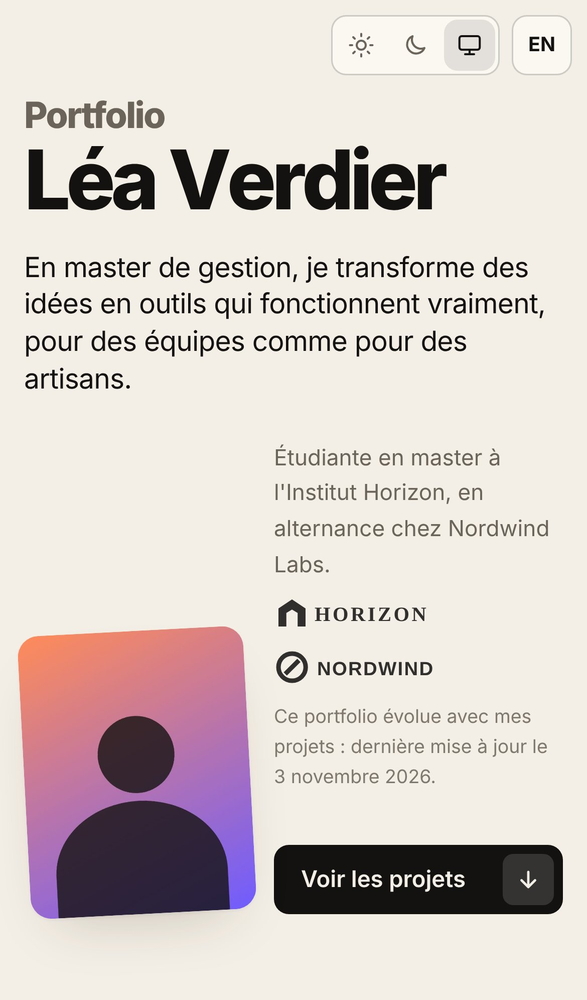

# Portfolio Template

[English version below](#english)

<p align="center"><a href="https://portfolio-spie.vercel.app"><b>Voir la démo en ligne</b></a> · <a href="https://portfolio-spie.vercel.app/?lang=en">Live demo (English)</a></p>

<p align="center"><a href="https://portfolio-spie.vercel.app"></a></p>
<p align="center"><sub>Clique sur l'animation pour ouvrir la démo.</sub></p>

<table>
<tr>
<td width="33%"></td>
<td width="33%"></td>
<td width="33%"></td>
</tr>
</table>

<p align="center"><sub>Chaque projet a sa couleur, et la page entière change de couleur au défilement. Thème clair, sombre ou automatique, FR et EN, mobile inclus. Contenu d'exemple fictif.</sub></p>

<p align="center">


</p>

Un portfolio animé, bilingue (FR/EN), avec thème clair, sombre ou automatique. **Tout le contenu tient dans un seul fichier** : `contenu.json`. Tu n'écris pas de code.

## Aperçu

- Ouverture : « Portfolio » et ton nom au centre, puis chacun à sa place.
- Présentation plein écran, avec ta photo et tes logos.
- Bande d'images qui défile en désordre (jamais deux images du même projet à la suite).
- Phrase qui s'allume mot par mot au défilement.
- Cartes projets plein écran : la couleur de toute la page change à chaque projet.
- Clavier d'outils interactif, bandes d'outils, section « autres projets », contact.
- Thème clair, sombre ou automatique selon l'appareil. Français et anglais (`?lang=en`).
- Optimisé pour mobile, avec une feuille d'impression pour exporter en PDF.

Le site s'adapte au nombre de projets : 1, 3 ou 6, la page se construit seule. Une section vide disparaît.

## Installation en 3 étapes

1. **Récupère le template**, de l'une de ces trois façons (détails dans [GUIDE.md](GUIDE.md#recuperer)) :
   - **Use this template** (recommandé) : bouton vert en haut de la page GitHub, puis **Create a new repository**. Tu obtiens ton propre dépôt.
   - **Download ZIP** : bouton **Code**, puis **Download ZIP**. Pratique si tu ne connais pas Git.
   - **Clone** : `git clone https://github.com/gab-spie/portfolio-template.git mon-portfolio`, puis `git remote remove origin`.
2. **Remplis `contenu.json` et `img/`**. Le plus simple : ouvre le dossier avec une IA (Claude Code, ChatGPT/Codex, Gemini, Cursor...) et dis « adapte ce portfolio à moi ». Elle te pose des questions (qui tu es, ton objectif, tes projets, tes couleurs, tes phrases) puis remplit tout. L'IA commence par te montrer à quoi ressemble le portfolio, puis te pose les questions par petites parties. Tu peux aussi remplir à l'avance [QUESTIONNAIRE.md](QUESTIONNAIRE.md). Détails : [INSTRUCTIONS-IA.md](INSTRUCTIONS-IA.md).
   Sans IA : modifie `contenu.json` à la main (champs décrits plus bas), remplace les images dans `img/`, puis lance `python3 sync-contenu.py`.
3. **Mets en ligne avec Vercel (fortement recommandé)**. Vercel est un hébergeur : il met ton site sur Internet et te donne une adresse (`prenom-nom-portfolio.vercel.app`). C'est gratuit pour un portfolio personnel, sans aucune commande, et le site se met à jour à chaque modification de ton dépôt GitHub. Marche à suivre : [GUIDE.md](GUIDE.md#vercel).
   **Nom conseillé : `prenom-nom-portfolio`**, en minuscules, sans accents ni espaces, mots séparés par des tirets (par exemple `lea-verdier-portfolio`). L'adresse vient de ce nom : le plus simple est de le donner à ton dépôt GitHub (par exemple lors de **Use this template**) ou au projet Vercel à l'import. Si l'adresse est déjà prise, Vercel ajoute des lettres au hasard : ajoute alors une adresse libre dans le projet Vercel, **Settings**, puis **Domains** (par exemple `prenom-nom-portfolio.vercel.app` ou une variante). Mets ensuite cette adresse dans `site.url` et synchronise.
   Le bouton ci-dessous crée une copie neuve du template dans ton GitHub et la met en ligne en quelques clics : [](https://vercel.com/new/clone?repository-url=https%3A%2F%2Fgithub.com%2Fgab-spie%2Fportfolio-template)
   Si tu as déjà ton dépôt, importe-le plutôt depuis vercel.com. Alternatives : GitHub Pages, Netlify, Cloudflare Pages ou un hébergement classique (c'est un site statique, sans étape de build).

> Si tu utilises ChatGPT dans le navigateur (sans accès aux fichiers) : colle-lui le contenu de `INSTRUCTIONS-IA.md`, puis celui de `contenu.json`. Il t'interroge, te rend un `contenu.json` complet à recoller et la liste des images à ajouter. Lance ensuite `python3 sync-contenu.py`.

> Guide détaillé pas à pas (récupérer le template, remplir, tester, Vercel et ses alternatives, PDF) : [GUIDE.md](GUIDE.md).

## Tester en local

```bash
python3 -m http.server 8000
# puis ouvre http://localhost:8000
```

Tu peux aussi ouvrir `index.html` directement (double-clic). La page lit alors `contenu.js`, une copie de `contenu.json` que le navigateur accepte de lire sans serveur.

> **Important : après chaque modification de `contenu.json`, synchronise.**
> Sinon, une page ouverte par double-clic affiche l'**ancien** contenu.
> - **Windows** : double-clique sur `synchroniser.bat`.
> - **Mac** : double-clique sur `synchroniser.command` (la première fois, clic droit, puis **Ouvrir**).
> - **Ou en ligne de commande** :
>
> ```bash
> python3 sync-contenu.py
> ```
>
> Il faut Python 3, gratuit sur [python.org](https://www.python.org/downloads/). Sur un serveur (Vercel, `http.server`), la page lit directement `contenu.json` : la synchro ne sert alors qu'à mettre à jour l'aperçu de partage.

Ce script vérifie ton JSON, signale les images introuvables, met à jour `contenu.js` et remplit les balises de partage (titre, description, image d'aperçu pour LinkedIn, WhatsApp, Slack...) dans `index.html`.

## Exporter en PDF

- Sans rien installer : ouvre le site, `Ctrl/Cmd + P`, « Enregistrer au format PDF », active « Graphiques d'arrière-plan ».
- Avec le script fourni : `npm i playwright`, `npx playwright install chromium`, puis `node exporter-pdf.js`. Il crée `portfolio-fr.pdf` et `portfolio-en.pdf`. Le script lit `contenu.js` : lance `python3 sync-contenu.py` avant.
- Pour proposer le PDF en téléchargement sur le site, mets les fichiers à la racine et renseigne `contact.pdf`.

<a id="champs"></a>

## Les champs de `contenu.json`

Un texte peut être une simple chaîne (identique dans les deux langues) ou `{ "fr": "...", "en": "..." }`.
Dans les textes, seules les balises `<b>`, `<strong>`, `<em>`, `<i>` et `<br>` sont gardées. Les chemins d'images sont relatifs à la racine (`img/mon-image.jpg`).
Tous les champs sont optionnels : un champ vide ne s'affiche pas.

### `site`
| Champ | Rôle |
|---|---|
| `url` | Adresse finale du site (pour les aperçus de partage). |
| `titre` | Titre de l'onglet et du partage. Par défaut : « Prénom Nom · » suivi de `identite.etiquette` (« Portfolio »). |
| `description` | Description du site (moteurs de recherche et partage). |
| `imagePartage` | Image d'aperçu, 1200 × 630 (par exemple `img/og.jpg`). |
| `couleurNavigateur` | Couleur de la barre du navigateur sur mobile (`#rrggbb`). |
| `langueParDefaut` | `"auto"` (langue de l'appareil), `"fr"` ou `"en"`. |
| `boutonLangue` | `false` pour masquer le bouton FR/EN (site dans une seule langue). |
| `miseAJour` | Date au format `AAAA-MM-JJ`. Sert au texte « mis à jour le » et au pied de page. Retire la clé pour ne rien afficher. |
| `credit` | Petite mention en bas de page : `afficher` (`true` ou `false`), `texte`, `nom`, `lien`. Elle n'apparaît que si `nom` est rempli. |

### `identite`
| Champ | Rôle |
|---|---|
| `prenom`, `nom` | Ton nom, affiché en très grand. |
| `etiquette` | Le petit mot au-dessus du nom. Par défaut : « Portfolio ». |
| `accroche` | Ta phrase d'accroche, sous le nom, à gauche de la photo. |
| `texte` | Court texte à côté de la photo. |
| `photo` | `{ "src", "alt", "largeur", "hauteur" }`. Sans photo, la page se réorganise. |
| `logos` | Logos d'école ou d'entreprise (optionnels) : `nom`, `src`, `lien`, `largeur` en pixels. Par défaut, le logo prend la couleur du texte. `"teinte": false` garde ses couleurs d'origine. |
| `miseAJourTexte` | Phrase sous les logos. `{date}` est remplacé par la date de `site.miseAJour`, `{nom}` par ton nom. Ne s'affiche que si `site.miseAJour` est rempli. |
| `bouton` | Texte du bouton qui mène aux projets. Par défaut : « Voir les projets ». |

### `phrase`
La grande phrase qui s'allume mot par mot. Elle résume ton fil rouge. C'est du texte brut : les balises y sont retirées. Retire la clé pour supprimer la section.

### `catalogue`
Liste des outils connus avec leur logo, pour ne pas les répéter : `"Python": { "logo": "img/logos/python.svg" }`.
`"mono": true` pour un logo noir qui doit s'inverser en thème sombre (Vercel, Notion, Next.js).
Ensuite, dans les listes d'outils, il suffit d'écrire `"Python"`. Un outil absent du catalogue s'affiche sans logo.

### `projets`
`titre` (titre de la section) et `liste` (autant de projets que tu veux). Pour chaque projet :

| Champ | Rôle |
|---|---|
| `id` | Identifiant court (lettres, chiffres, tirets). |
| `nom` | Nom court, utilisé dans les légendes de la bande d'images. |
| `couleurs` | `fond`, `texte`, `accent`, et en option `fondSombre` (fond utilisé en thème sombre). Au format `#rrggbb`. Choisis un fond sombre et un texte clair : l'interface passe en mode sombre sur les cartes. |
| `marque` | En option. Soit un logo `{ "logo": "img/...", "alt", "lien" }`, soit un mot-symbole `{ "texte": "ATELIER", "sous": "Lune" }`. |
| `titre` | Titre de la carte. `<em>...</em>` met un morceau en couleur d'accent. |
| `accroche` | Paragraphe de présentation. |
| `resultat` | Le résultat, en une phrase, en couleur d'accent. |
| `points` | Liste de points clés. `<b>` pour le début en gras. |
| `appris` | Encadré « ce que j'ai appris ». Le libellé n'est pas ajouté seul : écris-le dans le texte (`<b>Ce que j'ai appris :</b> ...`). |
| `chiffres` | Liste de chiffres clés, avec un trait de couleur sur le côté. `<b>` met le chiffre en couleur d'accent. |
| `noteChiffres` | Petite note sous les chiffres (période, source). |
| `outils` | Liste d'outils (noms du catalogue, ou `{ "nom", "logo", "mono" }`). |
| `captures` | Liste d'images : `src`, `alt`, `legende`, `largeur`, `hauteur`, plus les options ci-dessous. |

Options d'une capture : `"ouvrable": false` (l'image ne s'ouvre pas en grand et ne se glisse pas), `"type": "mobile"` (cadre vertical), `"bande": false` (n'apparaît pas dans la bande d'images).
La première capture est la grande : ne la mets pas en `mobile`. Les suivantes flottent autour : deux captures classiques et une mobile au maximum. Les autres n'apparaissent que dans la bande d'images.

### `schema` (optionnel)
Un fonctionnement en étapes reliées par des flèches (une méthode, une chaîne d'outils, un processus).
`titre`, `etapes` (liste de `{ "logos": ["Python"], "titre", "texte" }`), `routinesTitre` et `routines` (liste de `{ "logos", "titre", "texte" }`). Les `logos` sont des noms du catalogue. Retire la clé `schema` pour supprimer la section.

### `outils` (optionnel)
`titre`, `touches` (chaque touche : `nom`, `categorie`, `texte`, et `"large": true` pour une touche double) et, en option, `bandes` (deux listes de noms pour les bandes défilantes ; sinon elles sont déduites des touches).

### `autres` (optionnel)
`titre`, `intro` et `liste`. Chaque projet : `titre`, `texte`, `outils`, `images` (mêmes champs que les captures), `lien` (`{ "url", "label" }`), `taille` et `miseEnPage`.
- `taille` : `"grand"` (deux tiers de la largeur), `"petit"` (un tiers), `"complet"` (toute la largeur) ou absent (moitié).
- `miseEnPage` : `"cote"` (image sur le côté), `"une"` (une image en haut), `"large"` (image large), `"duo"` (deux images). Par défaut : `"duo"` avec deux images ou plus, sinon `"une"`.

### `contact` (optionnel)
`titre` (par exemple ta disponibilité), `mail`, `linkedin`, `liens` (liste de `{ "label", "url" }`) et `pdf` (`{ "fr": "portfolio-fr.pdf", "en": "portfolio-en.pdf", "label": { "fr": "...", "en": "..." } }`, ou `null`).

## Contenu du dépôt

| Fichier | Rôle |
|---|---|
| `contenu.json` | **Tout ton contenu.** |
| `img/` | Tes images et logos. |
| `index.html` | Le site (design et animations). |
| `contenu.js` | Copie générée de `contenu.json` pour l'ouverture directe. |
| `sync-contenu.py` | Vérifie le contenu et met à jour `contenu.js` et les balises de partage. |
| `synchroniser.bat`, `synchroniser.command` | Double-clic (Windows, Mac) pour lancer la synchronisation sans ligne de commande. |
| `exporter-pdf.js` | Export PDF avec Playwright. |
| `GUIDE.md` | Guide complet pas à pas (FR et EN). |
| `INSTRUCTIONS-IA.md`, `CLAUDE.md`, `AGENTS.md` | Consignes pour qu'une IA t'aide à tout remplir. |
| `QUESTIONNAIRE.md` | Questionnaire à remplir à l'avance, à donner à ton IA. |

Tout le contenu d'exemple (Léa Verdier, Orbite, Atelier Lune, Cartable, Nordwind Labs, Institut Horizon) est fictif. Les images d'exemple sont générées. Les logos d'outils appartiennent à leurs propriétaires.

## Licence

MIT, voir [LICENSE](LICENSE). Polices : SIL Open Font License, voir [fonts/README.md](fonts/README.md).

---

<a id="english"></a>

# Portfolio Template (English)

An animated, bilingual (FR/EN) portfolio with a light, dark or automatic theme. **All content lives in one file**: `contenu.json`. You write no code.

## What you get

An opening animation ("Portfolio" and your name in the centre, then in place), a full-screen intro with photo and logos, a shuffled strip of screenshots, a sentence that lights up word by word, full-screen project cards that change the page colour as you scroll, an interactive tool keyboard, scrolling tool bands, other projects, contact, mobile optimisations and a print stylesheet to export a PDF.
The page adapts to the number of projects. An empty section disappears.

## Install in 3 steps

1. **Get the template**, in one of three ways (details in [GUIDE.md](GUIDE.md#get-template)):
   - **Use this template** (recommended): green button at the top of the GitHub page, then **Create a new repository**. You get your own repository.
   - **Download ZIP**: **Code**, then **Download ZIP**. Handy if you do not know Git.
   - **Clone**: `git clone https://github.com/gab-spie/portfolio-template.git my-portfolio`, then `git remote remove origin`.
2. **Fill in `contenu.json` and `img/`**. Easiest: open the folder with an AI assistant (Claude Code, ChatGPT/Codex, Gemini, Cursor...) and say "adapt this portfolio to me". It first shows you what the portfolio looks like, then asks, a few questions at a time, about you, your goal, your projects, your colours and your sentences, then fills everything in. See [INSTRUCTIONS-IA.md](INSTRUCTIONS-IA.md): it is written in French, and the assistant talks to you in your language. Without an AI: edit `contenu.json` by hand, replace the images, then run `python3 sync-contenu.py`.
3. **Publish with Vercel (strongly recommended)**. Vercel is a hosting service: it puts your site online and gives you an address (`firstname-lastname-portfolio.vercel.app`). It is free for a personal portfolio, needs no command, and updates the site every time your GitHub repository changes. How to: [GUIDE.md](GUIDE.md#vercel-en).
   **Suggested name: `firstname-lastname-portfolio`**, lowercase, no accents or spaces, words separated by hyphens (for example `lea-verdier-portfolio`). The address comes from this name: the simplest is to give it to your GitHub repository (for example with **Use this template**) or to the Vercel project when importing. If the address is already taken, Vercel adds random letters: then add a free address in the Vercel project, **Settings**, then **Domains** (for example `firstname-lastname-portfolio.vercel.app` or a variant). Then put this address in `site.url` and sync.
   The button below creates a fresh copy of the template in your GitHub and deploys it in a few clicks: [](https://vercel.com/new/clone?repository-url=https%3A%2F%2Fgithub.com%2Fgab-spie%2Fportfolio-template)
   If you already have your repository, import it from vercel.com instead. Alternatives: GitHub Pages, Netlify, Cloudflare Pages or classic hosting (it is a static site with no build step).

Using ChatGPT in the browser without file access? Paste it `INSTRUCTIONS-IA.md`, then your `contenu.json`. It interviews you and returns a full `contenu.json` to paste back, plus the list of images to add. Then run `python3 sync-contenu.py`.

> Step-by-step guide (get the template, fill it in, test, Vercel and its alternatives, PDF): [GUIDE.md](GUIDE.md#english-guide).

## Test locally

```bash
python3 -m http.server 8000   # then open http://localhost:8000
python3 sync-contenu.py       # run after every change to contenu.json
```

Opening `index.html` directly (double-click) also works: the page then reads `contenu.js`, a generated copy of `contenu.json`.
**After every change to `contenu.json`, synchronise**, otherwise a page opened by double-click shows the **old** content. On Windows, double-click `synchroniser.bat`. On Mac, double-click `synchroniser.command` (the first time, right-click, then **Open**). Python 3 is required (free at [python.org](https://www.python.org/downloads/)). On a server (Vercel, `http.server`) the page reads `contenu.json` directly, so syncing only refreshes the share preview.

 `sync-contenu.py` validates your JSON, reports missing images, refreshes `contenu.js` and fills the share tags (title, description, preview image) in `index.html`.

## Export a PDF

Open the site and print to PDF (enable background graphics). Or run `npm i playwright`, `npx playwright install chromium`, then `node exporter-pdf.js` to get `portfolio-fr.pdf` and `portfolio-en.pdf`. The script reads `contenu.js`, so run `python3 sync-contenu.py` first. To offer the PDF on the site, put the files at the root and fill in `contact.pdf`.

<a id="fields"></a>

## Fields of `contenu.json`

A text is either a plain string (same in both languages) or `{ "fr": "...", "en": "..." }`. Only `<b>`, `<strong>`, `<em>`, `<i>` and `<br>` are kept inside texts. Everything is optional: an empty field is not displayed. The full tables are in the French section above.

- **`site`**: `url`, `titre` (default: "First Last · " followed by `identite.etiquette`), `description`, `imagePartage` (1200 × 630), `couleurNavigateur`, `langueParDefaut` (`"auto"`, `"fr"`, `"en"`), `boutonLangue` (`false` hides the FR/EN button), `miseAJour` (`YYYY-MM-DD`, remove it to hide the date), `credit` (`afficher`, `texte`, `nom`, `lien`: the small "Template by" line, shown only when `nom` is set; set `afficher` to `false` to remove it).
- **`identite`**: `prenom`, `nom`, `etiquette` (small word above the name), `accroche` (tagline), `texte` (text next to the photo), `photo` (`src`, `alt`, `largeur`, `hauteur`), `logos` (school or company logos: `nom`, `src`, `lien`, `largeur`; `"teinte": false` keeps the original colours), `miseAJourTexte` (`{date}` and `{nom}` are replaced; shown only when `site.miseAJour` is set), `bouton`.
- **`phrase`**: the big sentence that lights up word by word. Plain text: tags are removed.
- **`catalogue`**: known tools with their logo (`logo`, `"mono": true` for black logos that invert in dark mode), so lists can just say `"Python"`.
- **`projets`**: `titre` and `liste`. Each project: `id`, `nom`, `couleurs` (`fond`, `texte`, `accent`, optional `fondSombre`; use a dark background and light text), `marque` (logo `{ logo, alt, lien }` or wordmark `{ texte, sous }`), `titre` (`<em>` colours a part in the accent colour), `accroche`, `resultat`, `points`, `appris` (write the "What I learned:" label yourself), `chiffres`, `noteChiffres`, `outils`, `captures` (`src`, `alt`, `legende`, `largeur`, `hauteur`, `"ouvrable": false`, `"type": "mobile"`, `"bande": false`). The first screenshot is the large one, so do not make it `mobile`; at most two regular and one mobile screenshot float around it.
- **`schema`** (optional): `titre`, `etapes` (`logos`, `titre`, `texte`), `routinesTitre`, `routines`. Remove the key to remove the section.
- **`outils`** (optional): `titre`, `touches` (`nom`, `categorie`, `texte`, `"large": true`), `bandes` (two lists of names).
- **`autres`** (optional): `titre`, `intro`, `liste` (`titre`, `texte`, `outils`, `images`, `lien` `{ url, label }`, `taille`: `"grand"` two thirds, `"petit"` one third, `"complet"` full width, or none for half; `miseEnPage`: `"cote"`, `"une"`, `"large"`, `"duo"`).
- **`contact`** (optional): `titre`, `mail`, `linkedin`, `liens` (`label`, `url`), `pdf` (`fr`, `en`, `label`, or `null`).

All example content (Léa Verdier, Orbite, Atelier Lune, Cartable, Nordwind Labs, Institut Horizon) is fictional and the example images are generated. Tool logos belong to their owners.

## License

MIT, see [LICENSE](LICENSE). Fonts: SIL Open Font License, see [fonts/README.md](fonts/README.md).
